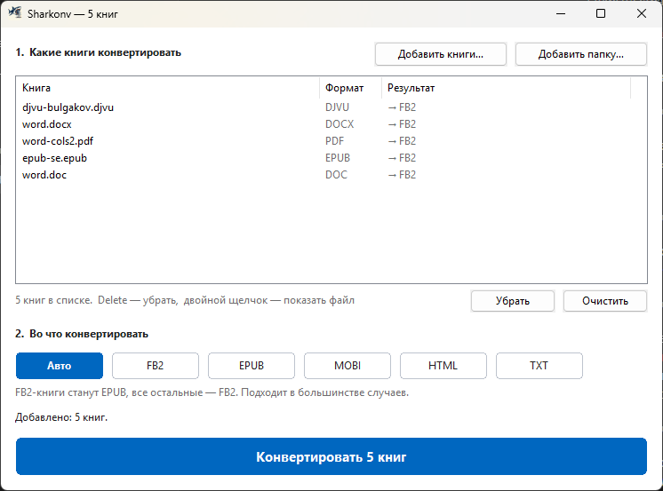

<p align="center"></p>

# Sharkonv

**Акула, которая съедает любую книгу и выдаёт её в нужном формате.**

Портативный конвертер книг для Windows XP SP3 … Windows 11 (32-битный PE, работает и на x64).
Без установки, без прав администратора, без записей в реестр. Один exe — вся программа.
До версии 1.7 назывался «FB2 Конвертер» (`fb2conv.exe`).

**Скачать:** [последний релиз](https://github.com/fogevmi/sharkonv/releases/latest) — `sharkonv-<версия>.zip`.

<p align="center"></p>

Поддерживаемые направления (все со всеми):

| Вход | Выход |
|---|---|
| FB2, FB2.ZIP / FBZ | FB2 |
| EPUB (2 и 3) | EPUB |
| MOBI / PRC / AZW | MOBI |
| PDF (с текстовым слоем) — *с 1.2* | HTML |
| DOCX, DOC (Word 97–2003) — *DOC с 1.5* | TXT |
| ODT — *с 1.2* | |
| RTF — *с 1.2* | |
| DjVu (с текстовым слоем) — *с 1.6* | |
| TXT, HTML | |

Готовая раздача: `dist\sharkonv-1.7.zip` (`sharkonv.exe` + `README.txt` для пользователя).

## Портативность

* **Один exe.** Без ключей — окно; с ключами (`-f`, `-o`, `-h`, `-v`) — консольный режим того же
  `sharkonv.exe`. Вывод идёт в перенаправление (`> log.txt`, конвейер), иначе в консоль родителя
  (`AttachConsole`), иначе в собственную консоль с ожиданием Enter (запуск ярлыком с ключами).
* **Настройки только в `sharkonv.ini` рядом с exe**: формат, последняя папка, положение окна.
  Пишется только изменившееся значение; папка только для чтения — ничего не пишется никуда.
  Манифест `asInvoker` выключает UAC-виртуализацию, поэтому копии в `VirtualStore` не появляется.
* **Ноль следов от диалогов.** Стандартные диалоги Windows сами пишут историю: последние
  файлы и папки в `HKCU\...\Explorer\ComDlg32` (даже с `OFN_DONTADDTORECENT`) и «shellbags» —
  настройки вида каждой впервые показанной папки (`...\Local Settings\...\Windows\Shell`,
  на XP `...\Windows\Shell` и `ShellNoRoam`). `NoTraceGuard` (`src/notrace.cpp`) снимает эти
  ветки до диалога и возвращает их байт-в-байт после: удаляет появившиеся значения и подключи,
  восстанавливает изменённые, не трогает неизменённые. Снимок ~0,1 с.
  `tools/notrace_test.cpp` доказывает это на настоящем диалоге, открытом в новой папке:
  без защиты меняются обе ветки, с защитой — ни одна; `RecentDocs` не трогается.
* Сама Windows отмечает запуск любого exe (Prefetch, MuiCache) — это вне программы.

## Сборка, проверка, упаковка

Нужен MinGW-w64 i686 (GCC 8.1.0 posix-dwarf) в `C:\dev\mingw32`
(или поправить `MINGW` в начале `build.bat`).

```
build.bat                       сборка build\sharkonv.exe
powershell -File tools\test.ps1 регрессионный тест
powershell -File tools\make_dist.ps1   dist\ + архивы
```

`tools\test.ps1` гоняет все входные файлы из `tests\` и `..\fb2-converter\testdata\`
через `sharkonv.exe` в консольном режиме во все 5 форматов, затем полученные EPUB и MOBI —
снова во все 5 (156 проверок вместе с остальными), и сверяет:

* каждый FB2 и каждый XML-файл внутри каждого EPUB — корректный XML;
* дерево разделов FB2 после круга FB2 → EPUB → FB2 и FB2 → MOBI → FB2 совпадает с прямым
  (заголовки с глубиной вложенности, серия, номера сносок, число ссылок `type="note"`);
* **книги, сделанные чужими программами** (`tests\corpus`, см. ниже) → FB2: дерево глав,
  название, серия, число сносок и ссылок на них, наличие жирного/курсива/таблиц/стихов, текст
  сносок не продублирован в основном тексте; PDF сверяется с DOCX того же документа **по каждому
  абзацу дословно** (переносы, колонтитулы, номера страниц, абзацы через границу страницы);
* текстовый слой DjVu — **каждая страница** против текста, который Викисклад извлёк из тех же
  файлов программами DjVuLibre (`.reftext.json`); DjVu без текстового слоя — отказ с причиной;
* консольный режим: версия и справка доходят до конвейера, неверный формат → код 2;
* диалог открытия не оставляет следов в реестре (`tools\notrace_test.cpp`);
* в exe нет импортов функций, которых нет в XP SP3.

### Корпус «чужих» книг (`tests\corpus`, `tools\make_corpus.ps1`)

Проверять конвертер на его же выходе мало — так проверяется только он сам. Корпус — файлы,
сделанные другими программами, у каждого рядом `.expect`: какое дерево глав и какие сноски
обязаны получиться в FB2.

| Файл | Откуда | Что проверяет |
|---|---|---|
| `word.docx/htm/rtf/odt/txt/pdf` | Microsoft Word (через COM, `make_corpus.ps1`) | стили «Заголовок 1–3» русского Word (id `1`,`2`,`3`), стиль «Заголовок» = название, сноски Word во всех форматах, таблица, список, картинка, PDF-закладки |
| `word-long.docx/.pdf/-nobm.pdf` | Word: 4 страницы по ширине, автоперенос, номера страниц | восстановление абзацев PDF (47 переносов на концах строк), главы из закладок и без них |
| `epub-calibre.epub` | структура Calibre | несколько глав в одном файле, оглавление на `#якоря`, сноски в другом файле, `calibre:series` |
| `epub-fb2style.epub` | структура EPUB из FB2-конвертеров | заголовки `<div class="title1">` без `<h1>` — только оглавление знает структуру |
| `epub-se.epub` | структура Standard Ebooks (EPUB 3) | `nav.xhtml`, части и главы в разных файлах, `endnotes.xhtml` с `↩` |
| `html-pandoc.html` | структура pandoc | `<h1>` = название книги, сноски `section.footnotes` |
| `word.doc`, `word-long.doc`, `word-media.doc`, `word-grid.doc` | Word: те же книги, сохранённые как Word 97–2003 | DOC сверяется с DOCX того же документа слово в слово; картинки побайтно те же |
| `word-media.docx/.pdf` | Word: JPEG-фото, PNG с прозрачностью, таблица с объединённой ячейкой и переносом строки в ячейке | картинки и таблица из PDF: число картинок, таблица ячейка в ячейку (с `colspan`) |
| `word-cols2/3.docx/.pdf` | Word: статья (вступление в одну колонку, главы в две, концовка в одну) и книга в три узкие колонки | порядок чтения колонок, абзацы через границу колонки, название из крупной первой строки при пустых свойствах PDF |
| `word-cols2i.docx/.pdf` | Word: книга в две колонки с красной строкой, концы предложений попадают на низ колонки | на переходе в колонку решает отступ, а не «короткая строка с точкой» |
| `word-grid.docx/.pdf` | Word: таблицы **без рамок**, числа с пробелами, ячейка с переносом текста, список рядом | таблица без рамок ячейка в ячейку, список таблицей не становится |
| `handmade-cols.pdf` | написан побайтно: колонки «как у LaTeX» — неровный правый край, межколонник 12 pt, правая колонка ниже левой | колонки не только от Word; абзацы сверяются с исходными дословно (`.paras`) |
| `handmade.pdf` | написан побайтно `tools\make_pdf_sample.ps1`, без офисных программ | классическая xref-таблица, стандартный Helvetica без `ToUnicode`, заголовки только по размеру шрифта, картинки 8 бит серый / 4-битная палитра / 1 бит с `Decode [1 0]` / CMYK — **сверка каждого пикселя** с узором, таблица из обведённых линий с `rowspan` |

| `djvu-bulgakov.djvu` | Викисклад: «Рассказы» Булгакова, 1926, 65 страниц | слой без координат (только текст) — абзацы по длине строк, переносы `¬` в том числе в словах КАПСОМ |
| `djvu-maugham.djvu` | Викисклад: рассказ Моэма из журнала | полное дерево зон с абзацами, мусор OCR (NUL, битый UTF-8) |
| `djvu-apples.djvu` | Викисклад: рассказ Ф. Дика из журнала, 8 страниц | строки без зон абзацев, вёрстка в две колонки |
| `djvu-janas.djvu` | Викисклад: польские стихи, 21 страница | стихи (короткие строки), польские буквы |
| `djvu-notext.djvu` | Викисклад: «Томские епархиальные ведомости», 1883 | скан без текстового слоя — понятный отказ |

`make_corpus.ps1` нужен только для пересоздания файлов Word — сами файлы лежат в проекте.
DjVu-файлы скачаны с Викисклада (свободные лицензии / общественное достояние), рядом —
`<имя>.reftext.json`: текст страниц из метаданных Викисклада (MediaWiki извлекает его DjVuLibre).

`tools\fuzz.ps1` — проверка на устойчивость: по 150 испорченных копий (обрезка, случайные байты,
блоки мусора) DOC, PDF, DOCX, RTF и DjVu; каждый запуск должен закончиться чисто (код 0 или 1) за 15 с.
В 1.6 — 1350 запусков, ни одного падения и зависания (первый прогон DjVu нашёл 88 падений:
смещение страницы из каталога `DIRM` битого файла не проверялось на выход за конец файла).

`tools\make_dist.ps1` собирает `dist\` и пересобирает `sharkonv-src.zip`
(проверено: архив распаковывается в чистую папку и собирается `build.bat` с `exit=0`).

`build.bat` намеренно в ASCII и с CRLF: cmd.exe неверно разбирает UTF-8-батники с LF
(именно так сборка ломалась при попытке запустить её из-под другой оболочки).

Сборка статическая (`-static -static-libgcc -static-libstdc++`), только Win32 API,
`_WIN32_WINNT=0x0501`, без `std::filesystem` и `std::thread` — поэтому exe запускается на XP.
Нужен `windres` (входит в MinGW) — он вшивает `src\app.rc`
(иконка, версия, манифест comctl32 v6 + asInvoker + dpiAware).

## Запуск

```
sharkonv.exe книга.fb2                    → окно, книга уже в списке
sharkonv.exe -f epub книга.fb2            → EPUB рядом с исходным файлом, без окна
sharkonv.exe -f fb2 D:\Книги              → все книги в папке (включая вложенные)
sharkonv.exe -f auto -o D:\Books D:\In    → в указанную папку
```

Параметры: `-f/--format auto|fb2|epub|html|txt|mobi`, `-o/--out <папка>`, `-h/--help`, `-v/--version`.
Без `-o` результат кладётся рядом с исходником (консольный режим перезаписывает, окно добавляет « (2)»).
В окне cmd — `start /wait sharkonv.exe …` (exe оконный, cmd его не ждёт); в .bat ждёт сам.

Окно — два шага и одна кнопка:

1. **Какие книги** — пока список пуст, вместо таблицы большая зона «Перетащите сюда книги или
   папки» (по щелчку — выбор файлов), плюс кнопки «Добавить книги…» и «Добавить папку…».
   В таблице у каждой книги видно исходный формат и во что она превратится (`→ EPUB`);
   после конвертации — зелёное «Готово: имя» или красная причина ошибки.
2. **Во что конвертировать** — все форматы сразу видны плашками (Авто · FB2 · EPUB · MOBI ·
   HTML · TXT), под ними одна строка, для чего формат.

Большая кнопка говорит, что будет сделано: «Конвертировать 3 книги в EPUB»; после ошибок —
«Попробовать ещё раз» (только книги с ошибкой). Смена формата снова делает все книги ждущими.
Двойной щелчок по строке — показать файл в проводнике, `Delete` — убрать, `Ctrl+O` — добавить.
Плашки и кнопка нарисованы программой сами, поэтому выглядят одинаково от XP до 11.

## Структура исходников

| Файл | Назначение |
|---|---|
| `src/common.h` | базовые типы, UTF-8/UTF-16, работа с путями и файлами |
| `src/util.cpp` | строки, кодировки (CP1251/1252/UTF-8), base64, HTML-сущности, даты, числа |
| `src/markup.h/.cpp` | собственный толерантный XML/HTML-парсер (без pugixml). Имена элементов хранятся без namespace-префикса — это нужно для DOCX (`w:p` → `p`) |
| `src/zip.h/.cpp` | чтение/запись ZIP-контейнера (EPUB, DOCX, FB2.ZIP); zlib используется только для raw deflate/inflate |
| `src/book.h/.cpp` | внутренняя модель книги (`Book`, `Meta`, `Chapter`, `Block`, `Note`, `Image`), нормализация, эвристики метаданных, дерево глав |
| `src/convert.h/.cpp` | диспетчер: `readBook` / `writeBook`, определение форматов |
| `src/readers.cpp` | читатели FB2, TXT, HTML, DOCX, ODT, EPUB, MOBI; общий разбор сносок для HTML/EPUB/MOBI |
| `src/rtf.cpp` | читатель RTF |
| `src/doc.cpp` | читатель DOC (Word 97–2003): контейнер OLE, таблица кусков, FKP, стили, сноски, таблицы, картинки |
| `src/pdf.cpp` | читатель PDF: объекты, xref, фильтры, шрифты, страницы, восстановление вёрстки |
| `src/djvu.cpp`, `src/djvu_ztable.h` | читатель DjVu: контейнер IFF, BZZ (ZP-кодер), текстовый слой, закладки, вёрстка |
| `tools/make_corpus.ps1` | пересоздание корпуса чужих книг (Word через COM + образцы EPUB/HTML) |
| `tools/fuzz.ps1` | устойчивость: испорченные копии DOC/PDF/DOCX/RTF/DjVu не должны ронять программу |
| `tools/notrace_test.cpp` | проверка «ноль следов» на настоящем диалоге Windows |
| `src/writers.cpp` | писатели FB2, EPUB, HTML, TXT, MOBI |
| `src/main.cpp` | `WinMain`: окно или консольный режим по ключам, `convertOne`, CLI |
| `src/notrace.h/.cpp` | снимок/откат веток истории (`ComDlg32`, shellbags) вокруг диалогов |
| `src/gui.cpp` | окно в два шага: зона перетаскивания/список, плашки форматов (owner-draw), большая кнопка |
| `src/app.rc`, `app.manifest`, `app.ico` | ресурсы exe |
| `tools/make_icon.ps1` | сборка `app.ico` из `docs/icon/*.png` (BMP-записи для XP, 256 px — PNG) |
| `docs/logo.webp`, `docs/icon/` | логотип и он же, уменьшенный под размеры значка |

## Внутренняя модель

* `Book` — метаданные (`Meta`), плоский список `chapters` с уровнями, `notes`, `images`.
* `Block` — абзац и иные блоки (`P`, `SUB`, `EMPTY`, `IMG`, `QUOTE`, `POEM`, `STANZA`, `V`, `AUTHOR`, `LI`, `PRE`, `RAW`).
  Текст внутри блока хранится как HTML-фрагмент (`strong`, `em`, `a`, `img` …), а не как готовая разметка формата.
* Картинки: `std::map<std::string, Image>` + дедупликация по SHA-1/хэшу содержимого; имена `img-001.jpg`.
* Главы: `Chapter { int level; std::string title; std::vector<Block> blocks; }`.
  Все писатели строят дерево через `buildTree()` и сами решают, как вкладывать разделы.

Пайплайн: `readBook()` → `Book` → `writeBook(book, target)` → байты. Формат никогда не читается
напрямую в другой формат, поэтому направлений «все со всеми» не требуется.

## Особенности реализации

* **EPUB**: `mimetype` первым и без сжатия; OPF/NCX/nav; XHTML по главам; примечания — отдельный `notes.xhtml`,
  ссылки `notes.xhtml#id` при чтении снова превращаются в `#id`.
* **MOBI**: свой PalmDOC-контейнер, PDB-заголовок, EXTH (100/503/524/501/201/202), `firstNonBook`,
  картинки отдельными записями, `recindex` с ведущими нулями; PalmDOC-сжатие при чтении поддерживается,
  при записи текст пишется без сжатия (проще и надёжнее).
* **DOCX**: уровень главы — по имени стиля «heading N» (так Word хранит встроенные стили на любом
  языке, хотя id у русского Word — `1`, `2`…), затем `outlineLvl`, затем родительский стиль;
  стиль Title/«Заголовок» — название книги; сноски и концевые сноски (`footnotes.xml`,
  `endnotes.xml`), таблицы, списки, надстрочный/подстрочный, зачёркнутый; строки автоматического
  оглавления Word («TOC N») пропускаются.
* **ODT**: `text:h` с `outline-level`, сноски `text:note` прямо в абзаце, стили автоматические и
  общие с наследованием, таблицы, списки, картинки, оглавление документа пропускается.
* **DOC** (Word 97–2003, с 1.5): свой разбор по [MS-CFB] и [MS-DOC].
  * Контейнер OLE: FAT, DIFAT, мини-поток, каталог; потоки `WordDocument`, `0Table`/`1Table`,
    `Data`, `SummaryInformation` (название и автор).
  * Текст — по таблице кусков (`Clx`/`PlcPcd`): сжатые 8-битные (cp1252) и UTF-16 куски; поля Word
    (`0x13 код 0x14 результат 0x15`, с вложенностью) — берётся результат; мягкие переносы,
    неразрывные дефисы, разрывы строк.
  * Свойства символов и абзацев — страницы FKP (`PlcBteChpx`/`PlcBtePapx`), sprm с размерами
    операндов по `spra`: жирный, курсив, зачёркнутый, надстрочный/подстрочный, скрытый текст.
  * Уровень заголовка — встроенный номер стиля `sti` 1–9 («heading N» на любом языке Word),
    затем `sprmPOutLvl` абзаца и стиля, затем родительский стиль; `sti` 62 — название книги;
    строки оглавления (`sti` 19–27) пропускаются; список — `sprmPIlfo` в абзаце или стиле.
  * Сноски и концевые сноски — свои диапазоны текста (`PlcffndRef/Txt`, `PlcfendRef/Txt`).
  * Таблицы — метки ячеек (`0x07`) и строк (`sprmPFTtp`); объединённая ячейка — одна широкая
    ячейка, `colspan` считается по общей сетке границ `sprmTDefTable` всех строк.
  * Картинки — `sprmCPicLocation` → PICF в потоке `Data` → записи OfficeArt (FBSE/BLIP) → PNG/JPEG.
  * Отказы с понятной причиной: DOC с паролем, Word 6/95.
* **RTF**: свой разбор групп и управляющих слов; кодовая страница каждого шрифта (`\fcharset`),
  а при `\ansicpg0` (так пишет Word) — по тому, в какой кодировке реально набран текст;
  `\uN` с `\ucN`; уровни — `\outlinelevel` и стили «heading N»; сноски `\chftn` + `{\footnote}`;
  таблицы `\cell`/`\row`; картинки PNG/JPEG из `\pict`, метафайлы пропускаются.
* **PDF**: текстовый слой → книга.
  * Разбор: xref-таблицы, xref-потоки и гибрид (`/XRefStm`), объектные потоки, цепочки `/Prev`;
    если таблица битая — объекты находятся сканированием файла. Фильтры Flate (с предикторами),
    LZW, ASCIIHex, ASCII85.
  * Шрифты: `ToUnicode` (bfchar/bfrange), WinAnsi/MacRoman/Standard, `Differences` с именами
    глифов (`uniXXXX`, кириллица `afii100xx`), ширины глифов для пробелов; жирный и курсив — по
    имени шрифта и `FontDescriptor`.
  * Страница: матрицы текста и графики, `Tj/TJ/'/"`, формы `XObject`, встроенные картинки
    пропускаются. Строки — по вертикальному перекрытию (надстрочный номер сноски остаётся в
    своей строке), пробелы — по зазорам.
  * Вёрстка: колонтитулы и номера страниц (у края страницы, только цифры или повтор на многих
    страницах) убираются; абзацы — по межстрочному интервалу, красной строке, короткой последней
    строке, тире диалога; переносы «сло-/во» склеиваются, абзац продолжается через границу страницы.
  * Главы — из закладок (`/Outlines`, включая именованные назначения), без закладок — по размеру
    шрифта. Сноски — надстрочный номер в тексте + мелкий текст с тем же номером внизу страницы.
  * Картинки (с 1.3): JPEG (`DCTDecode`) переносится как есть; сырые выборки собираются в PNG
    своим кодировщиком — серый, RGB, палитра (`Indexed`), CMYK (переводится в RGB), `ICCBased`,
    `Separation`; 1–16 бит; массив `Decode`; маска прозрачности `SMask` любого размера и `Matte`
    (цвет, заранее умноженный на прозрачность, пересчитывается обратно — иначе тёмные края).
    Отсеиваются значки меньше 16 pt, фон-скан под текстовым слоем (больше 85 % страницы) и
    картинка, повторяющаяся на половине страниц и чаще (логотип, фон). Картинка встаёт в поток
    текста по своему верхнему краю.
  * Таблицы (с 1.3): по линиям рамок — и обводкой (`S`), и заливкой тонких прямоугольников (так
    рисует Word); путь обрезки (`W n`) линией не считается. Линии сливаются, пересекающиеся
    группируются в сетку; ячейка без внутренней линии справа/снизу объединяется с соседней
    (`colspan`/`rowspan`); текст раскладывается по ячейкам и из абзацев убирается. Сетка из одной
    ячейки (рамка вокруг абзаца) и пустая сетка таблицей не считаются.
  * PDF из одних картинок (комикс, скан без текстового слоя) даёт книгу из картинок.
  * Колонки (с 1.4): по гистограмме покрытия текстом по горизонтали — межколонник это полоса, где
    текста намного меньше, чем по сторонам, а у её краёв много строк кончается и начинается.
    Выравнивание строк колонок по высоте не требуется (заголовок в одной колонке сдвигает её строки).
    Блок колонок — непрерывная серия строк, не перекрывающих межколонник целиком; от таблицы
    отличается «наполненностью» (строки прозы занимают колонку почти целиком) и шириной колонок.
    Порядок чтения: полоса над колонками, колонки слева направо, полоса под ними. Абзац переходит
    из колонки в колонку как через границу страницы; отступы и края — свои у каждой колонки.
  * Таблицы без рамок (с 1.4): подряд идущие строки из нескольких «кусков» текста с промежутками
    от 1,5 кегля, выровненных в столбцы; строка с пустым первым столбцом — продолжение ячеек
    (перенос текста в ячейке). Маркеры списков («•», «1.») рядом с текстом таблицу не образуют.
  * Колонтитул — строка у края страницы, повторяющаяся на многих страницах **и** отделённая от
    текста увеличенным промежутком (строка текста у края, пусть и повторяющаяся, остаётся).
  * Название книги, если в свойствах PDF его нет, — крупная первая строка первой страницы
    (с переносами на следующие строки того же кегля).
  * Отладка: `SHARKONV_PDFDEBUG=файл` пишет строки страниц, а `файл.layout` — разбор вёрстки:
    покрытие по горизонтали, найденные межколонники и блоки, причина каждого нового абзаца.
  * 130 страниц разбираются за ~0,3 с. Отладка: `SHARKONV_PDFDEBUG=файл` — строки страниц, как их
    увидел разбор.
* **DjVu** (с 1.6): только текстовый слой — сами картинки страниц не декодируются (IW44/JB2).
  * Контейнер IFF `AT&TFORM`: одностраничный `DJVU`, многостраничный `DJVM` с каталогом `DIRM`
    (встроенные страницы и «indirect» — страницы отдельными файлами рядом), общие `DJVI` через `INCL`.
  * BZZ — арифметический ZP-кодер + MTF + обратное BWT. Таблица вероятностей ZP взята из DjVuLibre
    (`ZPCodec.cpp`, GPL) — это данные формата, без неё поток не раскодировать; код декодера свой.
    Проверка: текст 98 страниц из 98 побайтно совпадает с тем, что выдаёт DjVuLibre.
  * Текстовый слой `TXTz`/`TXTa`: текст + дерево зон (колонка → область → абзац → строка → слово)
    с координатами относительно соседа или родителя. Порядок зон и есть порядок чтения.
  * Абзацы — по зонам абзацев, если они делят страницу (бывает, что вся страница — одна зона);
    иначе по геометрии: интервал, красная строка, короткая строка с концом фразы — с полями своей
    у каждой колонки; у слоя без координат — по длине строк в символах. Переносы `-` и `¬` (OCR)
    склеиваются, тире диалога начинает абзац. Колонтитулы и номера страниц — как в PDF.
  * Главы — из закладок `NAVM` (вложенные); название и автор — из `(metadata …)` в аннотациях.
  * Мусор OCR (NUL и прочие управляющие символы, битый UTF-8, `U+FFFD`) вычищается — иначе FB2
    не был бы корректным XML.
  * Отладка: `SHARKONV_DJVUDEBUG=файл` — сырой текст страниц (через `\f`), `файл.layout` — строки
    с координатами, колонками, зонами абзацев.
* **HTML/EPUB/MOBI — сноски**: ссылка-сноска узнаётся по разметке (`epub:type="noteref"`,
  `role="doc-noteref"`, классы footnote/noteref) или по виду — короткий номер «1», «[1]», «*»;
  её цель (абзац, пункт списка, блок или `<a name>` внутри него, как у Word) становится сноской
  книги и убирается из текста, обратные ссылки (`↩`) выбрасываются. Ссылка и сноска могут быть в
  разных файлах EPUB.
* **FB2**: терпимый разбор пространств имён (`l:href`), base64-бинарники, `coverpage`, сноски.
* **HTML**: один файл, картинки — `data:`; внешних ссылок на файлы не остаётся.
* **TXT**: определение кодировки (UTF-8/UTF-16/CP1251), разбиение на главы по эвристикам:
  «Часть/Книга/Том» — только с номером («Книга первая», «Часть II»), «Пролог/Эпилог» — вровень
  с частями, строки КАПСОМ (в том числе кириллицей).

## Изменения в 1.7

* **Новое имя — Sharkonv** (shark + conv) и логотип-акула вместо безликого «FB2 Конвертер»:
  `sharkonv.exe`, `sharkonv.ini`, переменные отладки `SHARKONV_PDFDEBUG` / `SHARKONV_DJVUDEBUG`,
  репозиторий `fogevmi/sharkonv` (старая ссылка на `fb2-converter-cpp` перенаправляется).
* Значок программы из логотипа: 16…128 px — BMP для XP, 256 px — PNG для проводника Vista и новее
  (`tools\make_icon.ps1` собирает `src\app.ico` из `docs\icon\*.png`).
* Старый `fb2conv.ini` рядом с программой при первом запуске переименовывается в `sharkonv.ini` —
  настройки не теряются.

## Изменения в 1.6

* **Новый входной формат — DjVu с текстовым слоем**, см. «Особенности реализации». Проверено на
  пяти книгах и журналах с Викисклада: русская книга 1926 г. (слой без координат), журнальные
  рассказы в две колонки, польские стихи; скан без текстового слоя даёт отказ с причиной.
* Название книги из имени файла: у PDF, DOC, ODT, RTF и DjVu без названия в свойствах в название
  попадало расширение («книга.pdf») — теперь оно отбрасывается, как у остальных форматов.
* `tools\fuzz.ps1`: добавлены DjVu — всего 1350 испорченных файлов без падений и зависаний.

## Изменения в 1.5

* **Новый входной формат — DOC (Word 97–2003)**, см. «Особенности реализации». На книгах из Word
  совпадает с DOCX того же документа: дерево глав, сноски, таблицы с объединённой ячейкой,
  списки, картинки (побайтно), текст абзацев слово в слово.
* Проверка на устойчивость `tools\fuzz.ps1`: 1050 испорченных файлов DOC/PDF/DOCX/RTF — ни
  одного падения или зависания.

## Изменения в 1.4

* **PDF: многоколоночная вёрстка и таблицы без рамок** (см. «Особенности реализации»).
  Проверено на статье в две колонки со вступлением и концовкой в одну, книге в три колонки,
  «латеховских» колонках, написанных побайтно, и таблицах без рамок от Word; на книгах в 132–150
  страниц в две и три колонки — ровно столько абзацев, сколько в исходнике, за 0,3–0,4 с.
* Найдено и исправлено по дороге: межколонники сливались в один, если первая строка страницы с
  пустой средней колонкой (поиск переделан на гистограмму); строка текста у верхнего края,
  повторяющаяся на многих страницах, выбрасывалась как колонтитул; абзац рвался на границе
  колонки или страницы, если там кончалось предложение.
* Проверка корпуса строже: таблица, которой в книге нет, — провал (так ловится текст, принятый
  за таблицу); абзацы можно сверять с файлом исходных абзацев (`paras=`).

## Изменения в 1.3

* **PDF: картинки и таблицы** (см. «Особенности реализации»). Проверено на картинках Word (JPEG и
  PNG с прозрачностью — совпадение всех пикселей с исходником) и на PDF, написанном побайтно, с
  картинками тех видов, что Word не создаёт; таблицы — с объединением ячеек по горизонтали и
  вертикали, нарисованные заливкой и обводкой.
* **HTML с диска: картинки рядом с файлом** (Word кладёт их в `имя.files/`) раньше терялись —
  теперь берутся с диска относительно HTML (`%20`, `file:///`, только расширения картинок).

## Изменения в 1.2

Проверено на корпусе книг, сделанных Word, Calibre, pandoc и по образцам Standard Ebooks и
FB2-конвертеров. Первый прогон по нему: из 10 файлов не прошёл ни один. Исправлено:

* **Сноски из чужих HTML, EPUB, MOBI не переносились вовсе** — читатель знал только сноски в
  файле `notes.xhtml` (то есть свои). Теперь — общий разбор (см. выше).
* **DOCX из настоящего Word читался без оглавления, сносок и таблиц**: разборщик XML принимал
  `<w:style>` за HTML-тег `<style>` и проглатывал весь `styles.xml` как сырой текст (заодно на
  каждом таком теге копировал весь документ — квадратичное время на больших HTML).
* **EPUB из FB2-конвертеров** (заголовки `<div class="title">`) давал пустое оглавление.
* Лишние разделы: «Примечания» как глава, `<h1>` с названием книги как корневой раздел.
* TXT: «Книга из Word» считалась частью книги; проверка «строка КАПСОМ» для кириллицы была
  перевёрнута (заглавные А–Я считались строчными).
* Новые входные форматы: **PDF, RTF, ODT**.
* `build.bat` удаляет старый exe перед сборкой — неудачная сборка больше не оставляет прежний
  exe, который тесты приняли бы за новый.

## Изменения в 1.1

* **Оглавление больше не «слетает»** через EPUB и MOBI (главный недостаток старых конвертеров):
  * EPUB-писатель строит вложенные `nav.xhtml` и `toc.ncx` (раньше — плоский список при `dtb:depth=3`);
  * EPUB-читатель берёт уровни глав из оглавления книги (nav, иначе ncx), а не из `h1/h2`
    каждого файла по отдельности — раньше подраздел в своём файле с `<h2>` становился главой;
    это работает и для чужих EPUB, где каждая глава — `<h1>` в своём файле;
  * MOBI-писатель пишет заголовки `h1..h4` по уровню (раньше все были `<h2>`).
* **Сноски MOBI восстанавливаются**: ссылки `filepos` (байтовые смещения) превращаются в якоря,
  раздел «Примечания/Сноски/Notes», на абзацы которого ведут ссылки, — в настоящие сноски.
  Работает и для MOBI из Calibre/kindlegen.
* **FB2: ссылки на сноски с `type="note"`** — FBReader, CoolReader, AlReader показывают их
  всплывающим окном (раньше атрибут терялся даже при FB2 → FB2).
* EPUB: серия читается (`belongs-to-collection` и `calibre:series`) и пишется в обоих видах —
  EPUB 2-читалки видят только `calibre:series`; аннотация сохраняет абзацы; номер сноски
  отделяется от текста.
* GUI: размеры масштабируются по системному DPI (125–150 % больше не мелко); выбранный формат
  запоминается в `sharkonv.ini` рядом с exe (портативно, без реестра).
* Портативная сборка: один `sharkonv.exe` вместо двух (консольный режим по ключам), последняя папка
  и положение окна в `sharkonv.ini`, диалог открытия не оставляет истории в реестре и в «Недавних».
* `build.bat` — ASCII + CRLF; добавлены `tools\test.ps1`, `tools\make_dist.ps1`, `tests\deep-toc.fb2`.

## Что осталось

1. Проверка на реальном XP SP3 (по импортам и версии подсистемы 4.0 exe совместимы,
   но живого запуска на XP не было).
2. PDF: в книгах, где абзацы разделены интервалом **без** красной строки, конец предложения на
   самом низу колонки или страницы неотличим от конца абзаца (признака в PDF нет) — абзац может
   разделиться надвое; с красной строкой этой проблемы нет. Таблицы без рамок с переносом текста в
   первом столбце, колонки разной ширины на развороте, врезки сбоку от текста. Зашифрованные
   PDF (даже с пустым паролем), картинки JPEG 2000 / JBIG2 / CCITT и CMYK-JPEG (пропускаются),
   распознавание сканов (OCR). Слово с настоящим дефисом на конце строки («кто-/то») склеивается
   без дефиса — словаря нет.
3. DOC: Word 6/95 и «быстрое сохранение» Word 97 (фрагментированные правки) не читаются; плавающие
   картинки (не в строке текста) и объединение ячеек по вертикали пропускаются.
4. DjVu: картинки страниц не переносятся (нужны декодеры IW44 и JB2), сканы без текстового слоя
   не распознаются; закладки `NAVM` и метаданные проверены только по спецификации — в корпусе нет
   файла с ними. Мусор OCR в самом слое (`ski -` вместо `skipped`) остаётся как есть.
5. Следующие форматы по распространённости: FB3, CHM; на выход — DOCX и RTF.
6. Перенести исправления 1.1–1.2 в HTML-версию (`..\fb2-converter\src`).
7. Мелочи GUI: сортировка списка, локализация ошибок чтения.

## Лицензия

GPL-3.0 (`LICENSE`). Таблица вероятностей ZP-кодера в `src/djvu_ztable.h` взята из DjVuLibre (GPL);
zlib — под лицензией zlib.

## Известные ловушки

* `build.bat` вызывает `g++` через `cmd.exe /c`: PowerShell ломается на запятых в `-Wl,--gc-sections`.
* Русский текст в консоли Windows может выглядеть «кракозябрами» — это кодировка консоли, не данных.
* Для XP нельзя использовать `GetTickCount64`, `InitializeCriticalSectionEx`, `GetLocaleInfoEx`,
  `std::filesystem`, `std::thread` — в коде их нет, при доработке не добавлять.
